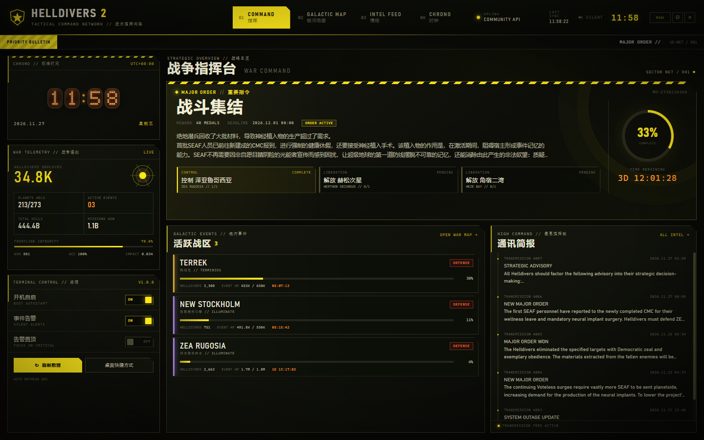
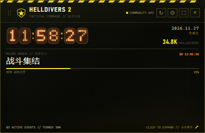
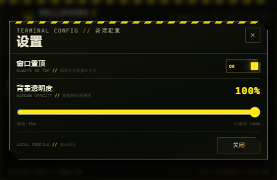

# HELLDIVERS 2 // TACTICAL COMMAND

一个面向 Windows 的《绝地潜兵 2》桌面战术终端。默认以**屏幕右下角的小挂件**待机，不占用任务栏；点击挂件展开为完整指挥台。深色军事终端界面、超级地球宣传语汇、银河战争地图、静默告警与像素辉光管时钟，开机后自动上线。

> 非官方粉丝作品，与 Arrowhead Game Studios / Sony 无关。游戏名称、设定与相关素材版权归其各自权利人所有。UI 与图标均为本项目自制，不使用游戏原始美术资源。

## 当前状态

- **v1.0.0**：桌面挂件 + 完整指挥台 + 银河地图 + 静默告警 + 窗口层级三态，已可日常使用。
- **v2 地基（M0）已落地**：SQLite 存储、单线程调度器、带限速/缓存的 HTTP 层、多游戏模块注册表（绝地潜兵 2 已接入；彩虹六号、英雄联盟、守望先锋 2 为占位条目）。备忘录、赛事、赛季倒计时尚未开工，相关特性开关默认关闭，计划见 [docs/ROADMAP-v2.md](docs/ROADMAP-v2.md)。

## 技术栈

Python 3.11 · pywebview 6（WebView2 / pywebview-winforms）· ctypes 直调 User32/Dwmapi · 原生 HTML/CSS/JS（无框架、无构建步骤）· SQLite（WAL）· Pillow · pystray · PyInstaller（`--onedir`）

- 窗口能力全部走原生 Win32：无边框、隐藏任务栏、DPI 感知、整窗透明度（`LWA_ALPHA`）、窗口层级、托盘闪烁。
- 前端零依赖：像素辉光管字形是手写 5×7 点阵 + CSS 辉光，银河地图是 Canvas 手绘。



## 桌面挂件 / 托盘



- 启动后默认是 `380 × 160`（最小 `340 × 140`）的右下角桌面挂件：左侧竖排「时间 / MO」两个标签页，时间页是大号像素辉光管时钟 + 日期/星期 + 在线人数，MO 页是重要指令标题 + 进度条 + 倒计时。横向拉伸时数字会按容器宽度自动放大。
- 窗口层级三档：**置底 / 通常 / 置顶**（默认置顶）。置底时窗口沉到所有普通窗口之下、点击它也不会再浮上来；无论哪一档，挂件都不会出现在任务栏，也不会出现在 Alt+Tab 列表。
- 单击挂件展开为完整指挥台；大窗右上角的 `MINI` 可收回挂件。
- 拖动挂件左上角的六点握把可移动位置。
- 点击挂件的 `×`、展开窗口的 `×` 或 `Alt+F4` 会隐藏到**系统托盘隐藏图标区**，不会退出。
- 托盘菜单：打开指挥台 / 收起到桌面挂件 / 窗口层级（置底·通常·置顶）/ 立即刷新 / 退出。置底被其他窗口完全遮住时，从这里也能把窗口捞回来。
- 小窗右上角提供刷新、设置、放大、隐藏四个按钮；大窗顶栏提供 `MINI`、设置、隐藏。
- 告警时挂件会出现红色优先通讯条并轻微闪烁；不会播放任何声音。
- 开机自启启动的是挂件模式，而不是大窗口。

## 打开与退出

- **从开始菜单打开**：按 `Win` 键输入 `Helldivers` 或 `helld`，回车即可。安装脚本只在开始菜单放一个入口，**默认不创建桌面图标**。
- **藏在托盘里时**：单击任务栏右下角的托盘图标（可能在 `^` 溢出区里）就能把它捞回来；第一次用 `×` 隐藏时会有托盘气泡提示。
- **真正退出**：托盘菜单 → `退出`。用开始菜单可以再次启动。
- ⚠️ `build\HelldiversTactical\HelldiversTactical.exe` 是 PyInstaller 的中间产物，旁边没有 `_internal` 目录，双击会报「找不到指定模块」。要运行请用安装目录的 exe、`dist\HelldiversTactical\HelldiversTactical.exe`，或开始菜单入口。

## 设置

点击小窗右上角 `⚙` 或大窗顶栏 `⚙` 打开设置：

- **窗口层级**：置底 / 通常 / 置顶，默认置顶。置底适合把挂件钉在桌面上当背景板；置顶时它会一直压在其他窗口上方。
- **背景透明度**：35%–100% 可调，拖动时实时预览并自动保存。

设置保存在安装目录的 `userdata\settings.json`（旧版在 `%LOCALAPPDATA%\HelldiversTactical\settings.json`，安装时会自动迁移）。透明效果作用于整个无边框窗口（LWA_ALPHA），所以背景变通透时文字也会同步变淡；这是桌面挂件常见的整窗半透明效果。



## 功能

- **桌面挂件模式**：右下角常驻小挂件，显示时间、MO、倒计时、事件摘要；单击展开完整指挥台，托盘/挂件可回收。
- **无任务栏打扰**：工具窗口样式，不占据任务栏；托盘图标位于隐藏图标区。
- **实时战争数据**：当前重要指令（MO）、任务目标、截止倒计时、奖励、银河事件、星球状态、战报、民主空间站、全战争统计。
- **静默告警**：新 MO、MO 进入终局、新行星攻防、银河级事件、战线易手、DSS 换位时，以红色优先通讯浮层 + 任务栏闪烁提醒，**不播放任何声音**。
- **银河战争地图**：基于真实星球坐标绘制 273 个星球、补给线、进攻箭头、MO 目标、活跃事件环与 DSS 轨道；支持拖拽、滚轮缩放、悬停资料卡与星球档案。
- **像素辉光管时钟**：自绘 5×7 像素字形、暖琥珀辉光、玻璃管反射与轻微闪烁；指挥台常驻 HH:MM，独立 CHRONO 页显示 HH:MM:SS。
- **HD2 风格界面**：黑黄配色、切角面板、危险条纹、扫描线、贝恩施里夫特窄体标题、双语军事播报语汇。
- **开机自启**：安装后在当前用户启动文件夹创建快捷方式，并可在应用内随时开关。

## 数据源

- **社区 API**：`https://api.helldivers2.dev/api/v1` —— 星球、事件、玩家数、战况统计。请求会携带该 API 要求的 `X-Super-Client` / `X-Super-Contact` 标识头。
- **ArrowHead 官方数据**：`https://api.live.prod.thehelldiversgame.com/api` —— 与社区数据并行请求，用于本地化重要指令标题、简报、银河级事件与民主空间站信息。
- **Helldivers Companion 中继**：`https://helldiverscompanion.com/api/hell-divers-2-api/get-api-data-live` —— 前两者都不可用时启用，并用于补全较新的最高指挥部通讯。
- 最近一次成功快照 / 内置存档快照 —— 完全离线时显示，并标注 `CACHE` / `ARCHIVE`。

界面右上角会显示当前实际数据源（正常为 `COMMUNITY API`）、最后同步时间和延迟。鼠标悬停 `UPLINK` 可查看主/备端点与错误详情。

## 安装

### 方式一：安装包（推荐）

1. 解压 `HelldiversTactical-v1.0.0-win64.zip`。
2. 右键 `安装并开机自启.bat` → 以管理员身份运行（普通用户权限通常也可）。
3. 安装到 `D:\工具\HelldiversTactical`（没有 D 盘时退回 `%LOCALAPPDATA%\Programs\HelldiversTactical`），同时创建**开始菜单项**与开机启动项（不建桌面图标）。
4. 启动后出现在屏幕右下角的小挂件；点击展开完整指挥台。用户数据（设置、日志、缓存、WebView2 配置）都放在安装目录的 `userdata\` 里，整个文件夹搬走即可。
5. 可在左侧 `TERMINAL CONTROL` 中开关 `开机自启`。

卸载：运行安装目录中的 `卸载.bat`，或再次运行 `install.ps1 -Uninstall`。退出应用请使用托盘菜单的 `退出`；点击窗口关闭按钮只会隐藏到托盘。

### 方式二：便携运行

直接双击 `HelldiversTactical\HelldiversTactical.exe`。首次启动会在右下角生成挂件，并在程序目录下的 `userdata` 创建缓存（便携模式）；若该目录不可写，才退回到 `%LOCALAPPDATA%\HelldiversTactical` 或系统临时目录。

> 请保持 `HelldiversTactical.exe`、`HelldiversTactical.exe.config` 和 `_internal` 文件夹在一起。`.exe.config` 用于允许 pythonnet 从非主分区加载本地程序集，缺少它可能导致启动失败。

## 快捷键

| 操作 | 功能 |
| --- | --- |
| 单击挂件 | 展开完整指挥台 |
| 拖动挂件握把 | 移动挂件 |
| `1` / `2` / `3` / `4` | 指挥台 / 银河地图 / 情报 / 时钟 |
| `R` | 立即刷新 |
| `Esc` | 关闭设置 / 当前告警 |
| 鼠标滚轮 / 拖拽 / 双击 | 地图缩放 / 平移 / 复位 |
| 展开窗口右上角 `MINI` | 收回桌面挂件 |
| 展开窗口右上角 `×` | 隐藏到托盘 |
| 托盘菜单 `退出` | 彻底退出进程 |

## 告警规则

- 首次运行只建立基线，不会补发历史告警。
- 新重要指令：`MAJOR_ORDER`，红色最高级。
- MO 剩余时间 ≤ 6 小时：`MO_EXPIRING`。
- 新行星事件：按事件最大生命值与在线人数评为 `HIGH` / `CRITICAL`。
- 新银河级事件（flag=1）：`GALACTIC_EVENT`。
- 有玩家的星球易手：聚合为一次 `FRONTLINE SHIFT`。
- 民主空间站换位：`DSS`。
- 所有提醒均为视觉提醒，不调用声音设备。

## 目录

```
app.py                      应用入口 / pywebview 控制器 / 托盘 / JS Bridge
hd2/api.py                  三路数据源、归一化、缓存
hd2/alerts.py               静默告警状态机
hd2/autostart.py            Windows 启动文件夹快捷方式
hd2/config.py               路径、设置、旧配置迁移
hd2/winflash.py             Win32 窗口几何 / 窗口层级 / 透明度 / 托盘闪烁
hd2/store.py                SQLite 地基（WAL，schema v1）
hd2/scheduler.py            单线程任务调度（间隔 + 指数退避）
hd2/netcache.py             带限速 / ETag / 退避的 HTTP 缓存
hd2/modules/                多游戏模块注册表 + 绝地潜兵 2 适配器
web/                        HTML / CSS / JS 前端（index.html、js/、css/）
data/planets.json           281 个星球静态资料（含简中名）
data/games.json             游戏注册表（hd2 / r6 / lol / ow2）
data/fallback_snapshot.json 内置离线快照
tests/                      M0 地基单元测试（stdlib unittest）
docs/ROADMAP-v2.md          v2 扩展功能规划（备忘录 / 赛事 / 赛季倒计时）
build.ps1 / install.ps1     PyInstaller 打包 / 安装脚本
dist/, build/, release/     构建产物（不入库）
```

## 开发运行

环境：Windows 10/11 + Python 3.11（需要 WebView2 运行时，Win11 自带）。

```powershell
python -m pip install -r requirements.txt
python app.py                 # 源码方式启动
python -m unittest discover -s tests -t .   # 单元测试（22 例）
```

调试 WebView（Chrome DevTools Protocol）：

```powershell
$env:HD2_DEVTOOLS = '1'
python app.py
# http://127.0.0.1:9223/json
```

打包与安装：

```powershell
.\build.ps1        # PyInstaller --onedir，产物在 dist\HelldiversTactical
.\install.ps1      # 复制到 D:\工具\HelldiversTactical（-InstallDir 可改）并建开始菜单/启动项
```

> 重新打包前请先退出正在运行的应用，否则 PyInstaller 会因 exe 被占用而清理 dist 失败。

## 常见问题

**启动时窗口一闪而过？**
查看安装目录下的 `userdata\logs\app.log`（旧版在 `%LOCALAPPDATA%\HelldiversTactical\logs\app.log`）。若提示 `Python.Runtime.Loader.Initialize`，确认 `HelldiversTactical.exe.config` 与 exe 同级。

**数据一直显示 `CACHE` / `ARCHIVE`？**
社区 API 与官方 API 都可能被网络环境阻断。应用会保留最近快照并明确标注。检查右上角 UPLINK 的悬停提示。

**告警没有弹出？**
左侧 `事件告警` 需为 ON；首次运行只建立基线。告警是静默的，请留意任务栏闪烁与右上角优先通讯浮层。

**开机没有自启？**
检查 `%APPDATA%\Microsoft\Windows\Start Menu\Programs\Startup\Helldivers Tactical Command.lnk` 是否存在，或在应用内关闭再开启一次 `开机自启`。

**任务栏里找不到它？**
这是预期行为。它是一个无边框工具窗口，入口在屏幕右下角的挂件和系统托盘隐藏图标区。若挂件被误隐藏，单击托盘图标（可能需要点开 `^` 隐藏图标区）即可恢复。

**怎么彻底退出？**
托盘菜单 → `退出`。关闭按钮、`Alt+F4` 都只是隐藏到托盘。
