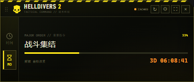
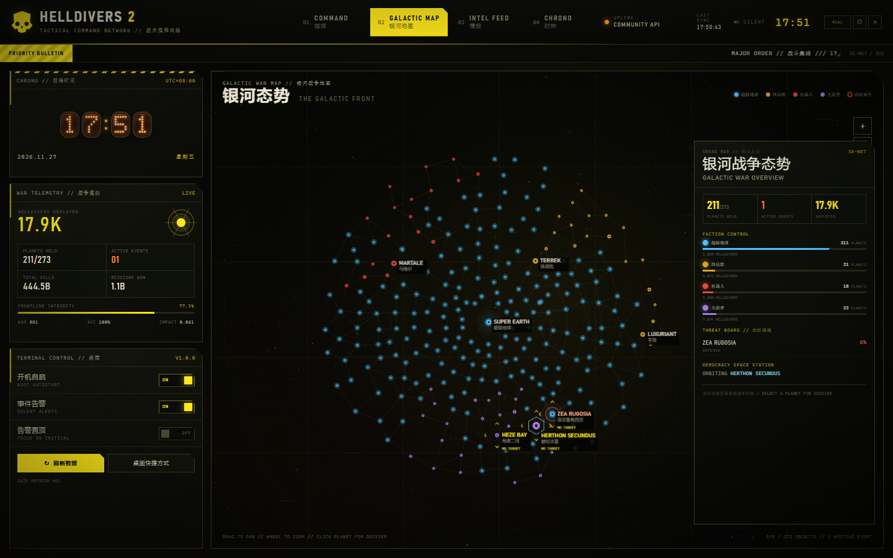
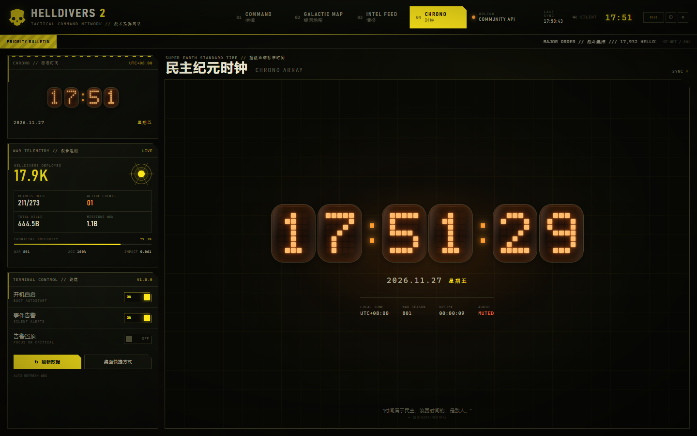
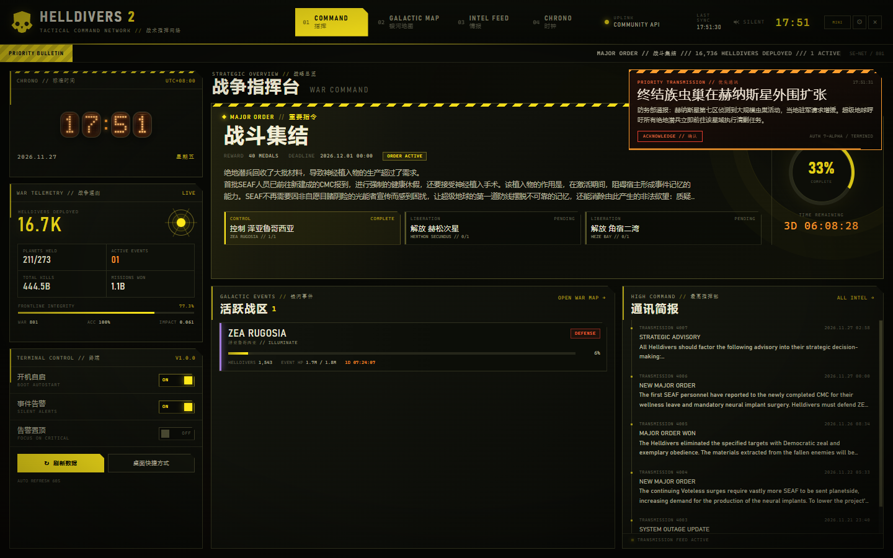

# HELLDIVERS 2 // TACTICAL COMMAND

<p align="center">
  
</p>

> **超级地球真理部 · 公民终端司 // SUPER EARTH MINISTRY OF TRUTH**
> 本终端已通过真理部认证，获准向公民实时播报银河战争进程。
> 记住：**管理民主，人人有责；服役，是公民唯一的自由。**

面向 Windows 的《绝地潜兵 2》桌面战术终端：默认以屏幕右下角的**小挂件**待机，不占任务栏、不打断工作；点击即展开为完整指挥台。深色军事终端界面、超级地球宣传语汇、银河战争地图、静默告警与像素辉光管时钟，开机自动上线。

> ⚠ **非官方粉丝作品**，与 Arrowhead Game Studios / Sony 无关。游戏名称与设定版权归其权利人所有；界面、图标与各项美术资源均为本项目自制，未使用游戏原始美术素材。

---

## ▚▚ 部署通告 // FIELD BRIEFING

| 项目 | 规格 |
| --- | --- |
| 平台 | Windows 10 / 11（WebView2） |
| 形态 | 无边框桌面挂件 `380 × 160`（最小 `340 × 140`）＋ 展开式指挥台 |
| 数据 | 社区 API · ArrowHead 官方接口 · Companion 中继，三路自动切换 |
| 声音 | **全程静默**，不占用音频设备 |
| 当前版本 | v1.0.0（v2 扩展地基已落地，见 [路线图](docs/ROADMAP-v2.md)） |

## ▚▚ 挂件与托盘 // THE WIDGET

<p align="center">
  
  &nbsp;&nbsp;
  
</p>

- **两块面板，一键切换**：左侧竖排「时间 / MO」标签。时间页是超大像素辉光管时钟 + 日期/星期 + 在线人数；MO 页是重要指令标题 + 进度条 + 截止倒计时。横向拉伸时数字按容器宽度自动放大。
- **窗口层级三档**：置底 / 通常 / 置顶（默认置顶）。置底时窗口沉到所有普通窗口之下，**点击它也不会再浮上来**；任何一档下，它都不会出现在任务栏与 Alt+Tab 列表里。
- **拖动**：按住左上角六点握把即可移动；展开后按 `MINI` 会**回到原来的位置**，而不是弹回右下角。
- **收起即入托盘**：点 `×` 或 `Alt+F4` 只隐藏到系统托盘隐藏图标区，不退出进程；首次隐藏会弹一次气泡提示位置。
- **托盘菜单**：打开指挥台 / 收起到桌面挂件 / 窗口层级（置底·通常·置顶）/ 立即刷新 / 退出。挂件被其他窗口完全压住时，从托盘子菜单也能把层级捞回来。
- 告警时挂件底部升起红色优先通讯条并轻微闪烁，**不发出任何声音**。
- 开机自启进入的是挂件模式，不会弹出大窗口。

## ▚▚ 打开与退出 // ACCESS PROTOCOL

- **从开始菜单打开**：`Win` 键 → 输入 `Helldivers` → 回车。安装脚本只写开始菜单项与开机启动项，**不创建桌面图标**。
- **藏在托盘里时**：单击右下角托盘图标（可能在 `^` 溢出区）即可召回。
- **真正退出**：托盘菜单 → `退出`。窗口关闭按钮只是收起。
- ⚠ `build\HelldiversTactical\HelldiversTactical.exe` 是 PyInstaller 的中间产物，旁边没有 `_internal`，双击会报「找不到指定模块」。请使用安装目录的 exe、`dist\HelldiversTactical\HelldiversTactical.exe` 或开始菜单入口。

## ▚▚ 指挥台巡礼 // INSPECTION TOUR

**银河战争地图**：按真实星球坐标绘制 273 个星球、补给线、进攻箭头、MO 目标、活跃事件环与 DSS 轨道；支持拖拽、滚轮缩放、悬停档案。四大阵营配色区分明确——超级地球蓝、终结族暗黄、机器人红、光能者紫。



**民主纪元时钟**：自绘 5×7 像素字形、暖琥珀辉光与玻璃管反射。指挥台常驻 HH:MM，CHRONO 页显示 HH:MM:SS 与所在时区、战季、运行时长。



**优先通讯**：新 MO、MO 终局、新行星攻防、银河级事件、战线易手、DSS 换位时，右上角升起红色通讯浮层并闪烁任务栏——依旧静默。



## ▚▚ 终端配置 // SETTINGS

<p align="center">
  
</p>

- **窗口层级**：置底 / 通常 / 置顶。置底适合把挂件钉成桌面背景板；置顶则始终压在其他窗口之上。
- **背景透明度**：35%–100%，拖动即时预览并自动保存。作用对象是整个无边框窗口（`LWA_ALPHA`），所以背景变通透时文字也会同步变淡。

配置写入安装目录的 `userdata\settings.json`（旧版位于 `%LOCALAPPDATA%\HelldiversTactical\settings.json`，安装时自动迁移）。

## ▚▚ 数据链 // DATA UPLINK

| 链路 | 端点 | 用途 |
| --- | --- | --- |
| 社区 API | `https://api.helldivers2.dev/api/v1` | 星球、事件、玩家数、战况统计（按对方要求携带 `X-Super-Client` / `X-Super-Contact`） |
| ArrowHead 官方 | `https://api.live.prod.thehelldiversgame.com/api` | 本地化 MO 标题、简报、银河级事件、民主空间站 |
| Companion 中继 | `https://helldiverscompanion.com/api/...` | 前两者不可用时接管，并补全新通讯 |
| 本地快照 | `userdata\cache\snapshot.json` / 内置存档 | 完全离线时显示，标注 `CACHE` / `ARCHIVE` |

右上角 `UPLINK` 实时显示当前数据源与最后同步时间；鼠标悬停可查看主/备端点与错误详情。

## ▚▚ 部署安装 // DEPLOYMENT ORDER

### 方式一：安装包（推荐）

1. 解压 `HelldiversTactical-v1.0.0-win64.zip`。
2. 右键 `安装并开机自启.bat` → 以管理员身份运行。
3. 安装到 `D:\工具\HelldiversTactical`（无 D 盘时退回 `%LOCALAPPDATA%\Programs\HelldiversTactical`），同时创建**开始菜单项**与开机启动项，**不建桌面图标**。
4. 启动即出现右下角挂件；用户数据（设置、日志、缓存、WebView2 配置）全部集中在安装目录的 `userdata\`，整个文件夹搬走即可。
5. 左侧 `TERMINAL CONTROL` 面板可随时开关 `开机自启`。

卸载：运行安装目录的 `卸载.bat`，或 `install.ps1 -Uninstall`。

### 方式二：便携运行

直接双击 `HelldiversTactical\HelldiversTactical.exe`。首次启动在程序目录下创建 `userdata`；若不可写，才退回 `%LOCALAPPDATA%\HelldiversTactical` 或系统临时目录。

> 请保持 `HelldiversTactical.exe`、`HelldiversTactical.exe.config` 与 `_internal` 文件夹同级。`.exe.config` 用于允许 pythonnet 从非主分区加载本地程序集。

## ▚▚ 快捷键 // CONTROLS

| 操作 | 功能 |
| --- | --- |
| 单击挂件 | 展开指挥台 |
| 拖动挂件握把 | 移动挂件 |
| `1` / `2` / `3` / `4` | 指挥台 / 银河地图 / 情报 / 时钟 |
| `R` | 立即刷新 |
| `Esc` | 关闭设置 / 当前告警 |
| 滚轮 / 拖拽 / 双击 | 地图缩放 / 平移 / 复位 |
| 右上角 `MINI` | 收回桌面挂件 |
| 右上角 `×` | 隐藏到托盘 |
| 托盘菜单 `退出` | 彻底退出进程 |

## ▚▚ 告警条例 // ALERT DOCTRINE

- 首次运行只建立基线，不补发历史告警。
- 新重要指令：`MAJOR_ORDER`，最高级。
- MO 剩余时间 ≤ 6 小时：`MO_EXPIRING`。
- 新行星事件：按事件最大生命值与在线人数评为 `HIGH` / `CRITICAL`。
- 新银河级事件：`GALACTIC_EVENT`。
- 有玩家的星球易手：聚合为一次 `FRONTLINE SHIFT`。
- 民主空间站换位：`DSS`。
- 全部为视觉提醒，**不调用声音设备**。

## ▚▚ 技术档案 // TECH DOSSIER

Python 3.11 · pywebview 6（WebView2 / winforms）· ctypes 直调 User32 / Dwmapi · 原生 HTML/CSS/JS（无框架、无构建步骤）· SQLite（WAL）· Pillow · pystray · PyInstaller（`--onedir`）

- 窗口能力全部走原生 Win32：无边框、隐藏任务栏、DPI 感知、整窗透明度（`LWA_ALPHA`）、窗口层级与「置底保持」看护线程、任务栏闪烁。
- 前端零依赖：像素辉光管字形是手写 5×7 点阵 + CSS 辉光，银河地图是 Canvas 手绘。
- v2 地基（M0）已落地：SQLite 存储、单线程调度器、带限速/ETag/退避的 HTTP 层、多游戏模块注册表。备忘录、赛事、赛季倒计时尚未开工，见 [docs/ROADMAP-v2.md](docs/ROADMAP-v2.md)。

## ▚▚ 编制目录 // MANIFEST

```
app.py                      应用入口 / pywebview 控制器 / 托盘 / JS Bridge
hd2/api.py                  三路数据源、归一化、缓存
hd2/alerts.py               静默告警状态机
hd2/autostart.py            Windows 启动文件夹快捷方式
hd2/config.py               路径、设置、旧配置迁移
hd2/winflash.py             Win32 窗口几何 / 窗口层级 / 透明度 / 托盘闪烁
hd2/store.py                SQLite 地基（WAL，schema v1）
hd2/scheduler.py            单线程任务调度（间隔 + 指数退避）
hd2/netcache.py             带限速 / ETag / 退避的 HTTP 缓存
hd2/modules/                多游戏模块注册表 + 绝地潜兵 2 适配器
web/                        HTML / CSS / JS 前端
data/planets.json           281 个星球静态资料（含简中名）
data/games.json             游戏注册表（hd2 / r6 / lol / ow2）
data/fallback_snapshot.json 内置离线快照
tests/                      M0 地基单元测试（stdlib unittest）
docs/ROADMAP-v2.md          v2 扩展功能规划
build.ps1 / install.ps1     PyInstaller 打包 / 安装脚本
dist/, build/, release/     构建产物（不入库）
```

## ▚▚ 公民开发指南 // DEVELOPMENT

环境：Windows 10/11 + Python 3.11（需 WebView2 运行时，Win11 自带）。

```powershell
python -m pip install -r requirements.txt
python app.py                              # 源码方式启动
python -m unittest discover -s tests -t .  # 单元测试（22 例）
```

调试 WebView（Chrome DevTools Protocol）：

```powershell
$env:HD2_DEVTOOLS = '1'
python app.py       # http://127.0.0.1:9223/json
```

打包与安装：

```powershell
.\build.ps1        # PyInstaller --onedir，产物在 dist\HelldiversTactical
.\install.ps1      # 复制到 D:\工具\HelldiversTactical（-InstallDir 可改）并建开始菜单/启动项
```

> 重新打包前请先退出正在运行的应用，否则 PyInstaller 会因 exe 被占用而清理 dist 失败。

## ▚▚ 公民问答 // FAQ

**启动时窗口一闪而过？**
查看 `userdata\logs\app.log`。若提示 `Python.Runtime.Loader.Initialize`，确认 `HelldiversTactical.exe.config` 与 exe 同级。

**数据一直显示 `CACHE` / `ARCHIVE`？**
网络环境可能阻断了社区或官方接口。应用会保留最近快照并明确标注，悬停 `UPLINK` 可查看原因。

**告警没有弹出？**
左侧 `事件告警` 需为 ON；首次运行只建立基线。所有告警都是静默的，请留意任务栏闪烁与右上角通讯浮层。

**开机没有自启？**
检查 `%APPDATA%\Microsoft\Windows\Start Menu\Programs\Startup\Helldivers Tactical Command.lnk`，或在应用内关闭再开启一次 `开机自启`。

**任务栏里找不到它？**
预期行为。它是无边框工具窗口，入口只有右下角挂件与托盘隐藏图标区。

**怎么彻底退出？**
托盘菜单 → `退出`。关闭按钮与 `Alt+F4` 都只是隐藏到托盘。

---

> **真理部提醒**：本终端播放的全部内容均由超级地球官方核准。如发现异见、虫巢同情言论或未经授权的和平主义倾向，请立即向最近的民主官报告。
> **为超级地球服役，直至银河光复。**
